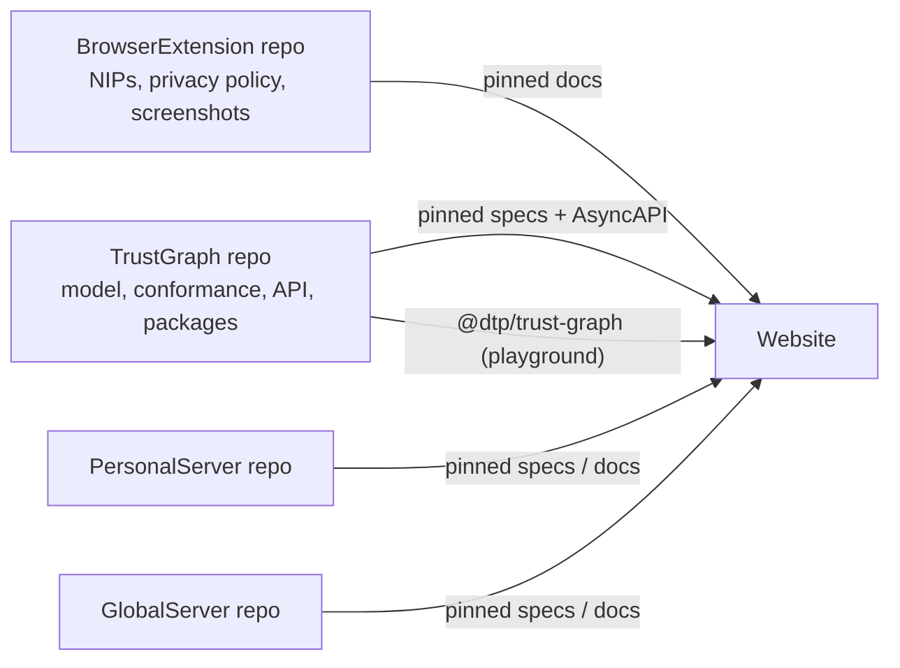

# Website

The public home of the Digital Trust Protocol: what digital trust is, how
trust (`32009`) and rating (`32014`) statements work, the resolver rules,
documentation and specs, links to the code, and the product pages for
Attention (browser extension), Personal Server, and Global Server.

Status: **design** (specs only, no code yet) · 2026-09-30

## Specs

| Spec | Contents |
| --- | --- |
| [specs/site.md](specs/site.md) | Audiences, sitemap, page specs, privacy-policy URL continuity, copy rules |
| [specs/content-pipeline.md](specs/content-pipeline.md) | Rendering specs from their owner repos at pinned commits; link rewriting; languages; API reference |
| [specs/tech.md](specs/tech.md) | Stack, repository layout, playground, hosting, budgets, accessibility, SEO, site privacy |

## How it fits

The Website never owns a spec. It renders each one from the repo that owns
it, at a pinned commit, and runs the real TrustGraph code in the playground.

## Increments

| ID | Increment |
| --- | --- |
| W1 | Skeleton, Home, Attention page, privacy policy (URL continuity), Code page, deploy to GitHub Pages |
| W2 | Content pipeline: NIPs, two questions, model and conformance pages rendered from source |
| W3 | Digital trust essay, How it works, playground on `@dtp/trust-graph` (needs TrustGraph P0) |
| W4 | Docs: protocol reference from AsyncAPI, Personal Server and Global Server pages and guides |
| W5 | Translations of authored pages into the seven locales |

## Open decisions

| ID | Decision |
| --- | --- |
| W-D1 | Domain (`trust.dance`?) and host (GitHub Pages vs Cloudflare Pages) |
| W-D2 | React Router v7 prerender vs `vite-react-ssg` |
| W-D3 | Whether the NIP documents move from the extension repo to a dedicated protocol repo |
